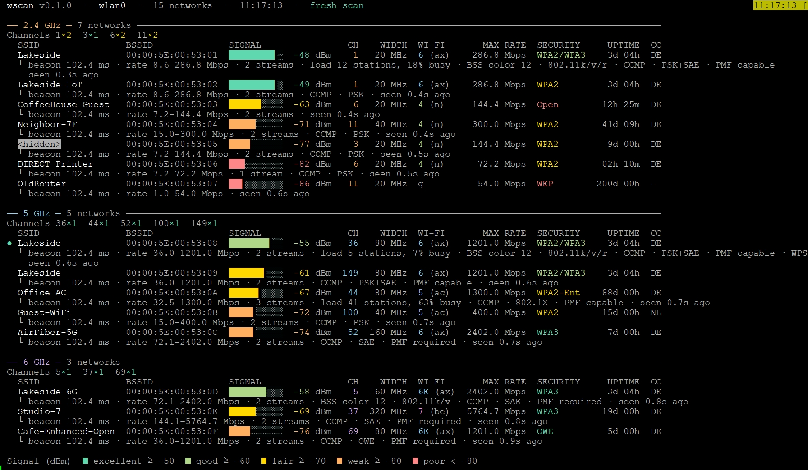

# 📡 wscan

[](https://github.com/rguziy/wscan/actions/workflows/ci.yml)

A small, colourful console Wi-Fi scanner written in pure Go. It lists the
access points around you grouped by band (2.4 / 5 / 6 GHz) and shows what each
one advertises: signal, channel, width, Wi-Fi generation, data rates, security,
uptime, country and more. Think of a console-sized WinFi or Wi-Fi Analyzer.

No CGO, no `iw`, no NetworkManager: on Linux `wscan` talks to the kernel
directly over generic netlink (`nl80211`), on Windows it calls the Native Wifi
API (`wlanapi.dll`), and on both it decodes the beacon information elements
itself. The result is a single static binary.

> **Status:** Linux and Windows are supported. macOS builds compile, but only
> `--demo` works there until its scanner is written.



## 📑 Contents

- [How it works](#-how-it-works)
- [Installation](#-installation)
- [Quick start](#-quick-start)
- [Flags](#-flags)
- [Channel recommendations](#-channel-recommendations)
- [What is shown](#-what-is-shown)
- [Permissions](#-permissions)
- [JSON output](#-json-output)
- [Exit codes](#-exit-codes)
- [Platform support](#-platform-support)
- [Building from source](#-building-from-source)
- [License](#-license)

## 📖 How it works

1. On Linux `wscan` opens a generic netlink socket and resolves the `nl80211`
   family; on Windows it opens a WLAN API handle.
2. It picks a Wi-Fi interface (the first station interface, or `--interface`).
3. Unless `--cached` is given, it asks the system for a fresh active scan and
   waits for the completion event. On Linux a scan that the kernel aborts
   (usually because NetworkManager or `wpa_supplicant` started its own) is
   repeated up to three times with a growing pause before falling back to the
   cached results.
4. It reads the scan table and decodes every beacon / probe response: HT, VHT,
   HE and EHT capabilities and operation elements, RSN / WPA, country, BSS
   load, roaming (802.11k/v/r), BSS colour and the beacon timestamp (AP uptime).
5. It groups the networks by band and draws them with signal bars and colours.

## 📦 Installation

### Release archives

Download the zip for your platform from the
[Releases](https://github.com/rguziy/wscan/releases) page, verify it against
`SHA256SUMS`, and unpack it:

```sh
sha256sum -c --ignore-missing SHA256SUMS
unzip wscan_1.1.0_linux_amd64.zip
sudo install -m 0755 wscan /usr/local/bin/
```

Archives are provided for `linux_amd64`, `linux_arm64`, `linux_armv5`,
`linux_armv6`, `linux_armv7`, `windows_amd64` and `windows_arm64`.

### With Go

```sh
go install github.com/rguziy/wscan/cmd/wscan@latest
```

### From source

See [Building from source](#-building-from-source).

## 🚀 Quick start

```sh
sudo wscan                 # fresh scan, all bands
sudo wscan -d              # add a line of extra details per network
sudo wscan -b 5,6          # only 5 and 6 GHz
sudo wscan -w              # live view, rescans every 5 seconds
wscan --cached             # no root: show what the kernel already knows
wscan --demo               # made-up networks, no Wi-Fi hardware needed
sudo wscan -r              # which channels should my router use?
```

On Windows run it from Windows Terminal, PowerShell or `cmd` (no administrator
rights needed):

```powershell
.\wscan.exe -b 5 -d
```

## 🚩 Flags

| Flag | Description |
| --- | --- |
| `-i`, `--interface NAME` | Wi-Fi interface to scan (default: first station interface) |
| `-b`, `--band LIST` | `all`, or a comma separated list of `2.4`, `5`, `6` |
| `-s`, `--sort KEY` | `signal` (default), `channel`, `ssid` or `bssid` |
| `-d`, `--details` | Add extra lines below every network |
| `-w`, `--watch` | Keep scanning and redraw the screen |
| `--interval DUR` | Time between scans in `--watch` mode (default `5s`, minimum `1s`) |
| `--cached` | Only read the system's cached results; needs no root on Linux |
| `--timeout DUR` | How long to wait for a fresh scan (default `15s`) |
| `--json` | Print JSON instead of tables |
| `--color MODE` | `auto` (default), `always` or `never` |
| `-r`, `--recommend` | Recommend the least loaded channels for each band, see [below](#-channel-recommendations) |
| `--scans N` | Scans to average in `--recommend` mode (default `3`, max `20`) |
| `--scan-interval DUR` | Pause between those scans (default `2s`) |
| `--ignore LIST` | SSIDs or BSSIDs to leave out of `--recommend`; repeatable and comma separated |
| `--include-connected` | Do not ignore the connected network in `--recommend` |
| `--country CC` | Two letter country code selecting the allowed channels |
| `--width MHZ` | Channel width to recommend on 5 and 6 GHz: `20`, `40`, `80` (default), `160`, `320` |
| `--list-interfaces` | List the Wi-Fi interfaces and exit |
| `--demo` | Show made-up networks (no Wi-Fi hardware needed) |
| `-V`, `--version` | Print the version and exit |
| `-h`, `--help` | Show help |

Colours follow the [`NO_COLOR`](https://no-color.org) convention and are
switched off automatically when the output is not a terminal.

## 🎯 Channel recommendations

Flaky Wi-Fi is very often a crowded channel. `wscan --recommend` scans several
times, averages the results and ranks the channels of every band by how little
they overlap with the networks around you, so you can set the best ones in your
router.

```sh
sudo wscan -r                          # 3 scans, 80 MHz on 5 and 6 GHz
sudo wscan -r --scans 5 --width 40     # more scans, narrower channels
sudo wscan -r --ignore "MyWiFi-Guest,MyWiFi-IoT"
sudo wscan -r -b 5 --json              # machine readable
```

Every candidate shows the **channel to enter in the router together with its
frequency and the spectrum it occupies**, for example channel `149` is
`5745 MHz` and an 80 MHz channel on it spans `5735–5815 MHz`, so there is no
need to look up which frequency a channel number stands for:

```
  ── 5 GHz ─ 80 MHz · 3 networks ──────────────────────────────────────────
  #     CH  FREQUENCY   WIDTH           SPAN  LOAD               SCORE
  1    149   5745 MHz  80 MHz  5735–5815 MHz  ░░░░░░░░░░  clear   0.00
  2    116   5580 MHz  80 MHz  5570–5650 MHz  ░░░░░░░░░░  clear   0.00  DFS
  3     52   5260 MHz  80 MHz  5250–5330 MHz  ▌░░░░░░░░░  clear   0.07  DFS
  now   36   5180 MHz  80 MHz  5170–5250 MHz  █▌░░░░░░░░  light   0.50
```

The `now` row is where your connected network sits at the moment, scored the
same way, so you can see what changing the channel would buy you.

**Your own router is left out.** Your own networks would otherwise count as
interference. The SSID of the network you are connected to is ignored
automatically (all its bands), and `--ignore` takes a list of further SSIDs or
BSSIDs, because a router often broadcasts several networks (guest, IoT). When
other networks share the connected router's hardware address, `wscan` points
them out so you can add them. Use `--include-connected` to count everything.

**Country.** The channels a router may use depend on the country. By default
the country announced by the connected network is used, otherwise the most
common one among the networks around; `--country UA` sets it explicitly.

**How the score works.** For every candidate channel (a block of channels at
the chosen width) `wscan` adds up the networks whose spectrum overlaps it. Each
one counts more the stronger its signal is (nothing below about -95 dBm, full
weight from -40 dBm), more if it advertises a busy channel, and less if it was
only seen in some of the scans. A score of 0 means empty; one strong network on
the same channel is about 0.7. The levels are `clear` (below 0.15), `light`,
`moderate` and `heavy` (above 1.5).

| Band | What is recommended |
| --- | --- |
| 2.4 GHz | Channels 1, 6 and 11 at 20 MHz, the only ones that do not overlap |
| 5 GHz | Blocks of the chosen width. Channels 52–144 are marked **DFS**: they must yield to radar, so the router may leave them without warning; on a tie a non-DFS channel is preferred |
| 6 GHz | Blocks of the chosen width; Europe has the lower 6 GHz only (5945–6425 MHz) |

**Bands your adapter cannot scan.** On Linux `wscan` asks the kernel which bands
the adapter has. A band the hardware lacks is reported as such, and a band that
is present but switched off by the regulatory domain says so and suggests
setting the country (for example `sudo iw reg set UA`), instead of ranking
channels from no data. On Windows the adapter's bands are not reported, so an
empty band is ranked with a note that it is empty or not scannable.

This is a heuristic, not a guarantee. A single scan is a snapshot, so use
several; the regulatory tables are simplified (European rules, US-like and
Japan) and your router only offers the channels its firmware allows, so when a
recommended channel is missing in its settings take the next one.

## 🎨 What is shown

Every band gets its own section with a channel summary (how many networks sit
on each channel) and a table:

| Column | Meaning |
| --- | --- |
| SSID | Network name; `<hidden>` for hidden networks, `●` marks the one you are connected to |
| BSSID | Access point MAC address |
| SIGNAL | Bar plus RSSI in dBm, coloured from excellent (≥ -50) to poor (< -80) |
| CH | Channel number |
| WIDTH | Channel width, 20 to 320 MHz |
| WI-FI | Generation and standard, for example `6 (ax)`, `6E (ax)`, `5 (ac)`, `7 (be)` |
| MAX RATE | Highest PHY rate the AP advertises |
| SECURITY | Open, WEP, WPA, WPA2, WPA3, WPA2/WPA3, OWE, enterprise variants |
| UPTIME | AP uptime derived from the beacon timestamp |
| CC | Country code from the AP's country element |

With `--details` each network gets extra lines: beacon interval, minimum and
maximum rate, spatial streams, BSS load (stations and channel utilisation),
BSS colour, roaming support (802.11k/v/r), ciphers, key management, PMF, WPS
and how long ago the network was last seen.

## 🔐 Permissions

**Linux.** Reading the kernel's cached scan table needs no special rights, but
the kernel drops cache entries after about 30 seconds unless something keeps
scanning, so the cached list can be empty. Triggering a **fresh** scan needs
root or `CAP_NET_ADMIN`. Without it `wscan` falls back to the cached results
and prints a note saying so.

To run without `sudo`, grant the capability to the binary once (repeat after
every rebuild):

```sh
sudo setcap cap_net_admin+ep /usr/local/bin/wscan
```

If NetworkManager or `wpa_supplicant` is already scanning, `wscan` waits for
that scan and uses its results.

**Windows.** No administrator rights are needed. Windows 11 24H2 and later
only return Wi-Fi scan results to applications that are allowed to use the
location service: turn on *Settings > Privacy & security > Location* (and
*Let desktop apps access your location*). Without it the list is empty and
`wscan` says so. The adapter description is used as the interface name, so
`--interface` accepts the text shown by `--list-interfaces`.

## 🧾 JSON output

`--json` prints one document with the interface, the scan time, whether the
results are fresh, any notes, and the list of networks. Together with
`--watch` it prints one compact JSON object per line.

```sh
sudo wscan --json -b 5 | jq '.networks[] | {ssid, channel, signal_dbm}'
```

## 🚦 Exit codes

| Code | Meaning |
| --- | --- |
| 0 | Success |
| 1 | Runtime error (no Wi-Fi interface, scan failed, ...) |
| 2 | Usage error (bad flag or value) |

## 🖥️ Platform support

| Platform | Status |
| --- | --- |
| Linux | ✅ Supported (`nl80211`, pure Go) |
| Windows | ✅ Supported on 64-bit Windows 10 and later (Native Wifi API, pure Go) |
| macOS | 🚧 Planned (CoreWLAN has no pure Go path; limits apply) |

On Windows the AP age ("seen ... ago") is not reported by the system and is
omitted. Only the scanner is platform specific. Element decoding, rate computation,
security classification and rendering are shared.

## 🔨 Building from source

Requirements: Go 1.24 or newer, `make`, and `zip` for release archives.

```sh
make              # list the targets
make build        # host binary in dist/wscan
make test         # go vet and go test
make demo         # build and run with made-up networks
make all          # cross-compile all targets, zip archives and SHA256SUMS
make VERSION=1.1.1 linux-arm64
```

All builds are static (`CGO_ENABLED=0`). The project has no third-party
dependencies.

```
cmd/wscan/          command line interface
internal/genl/      minimal generic netlink client
internal/wifi/      nl80211 and WLAN API scanners, information element decoding, rates, security
internal/render/    terminal colours, tables, signal bars
internal/version/   build version injected at link time
```

## 📄 License

[MIT](LICENSE)
